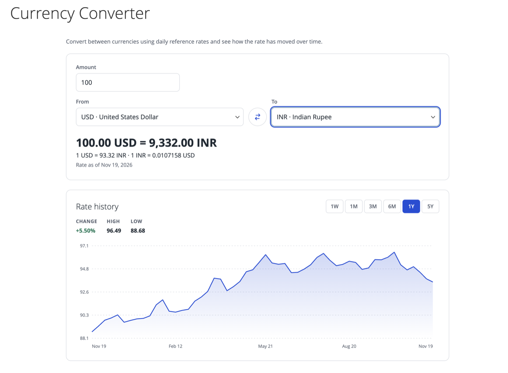

# Sidelah_CurrencyConverter

A Magento 2 module that adds a storefront currency converter page backed by the
[Frankfurter API](https://frankfurter.dev). A shopper picks any currency Frankfurter
supports as From and To, sees the current exchange rate, converts an amount, swaps the
pair with one click, and sees how the rate has moved over time on a chart.

Storefront URL: `/currency-converter`



## Features

- All 200 currencies from Frankfurter v2 (`/v2/currencies`), grouped as Currencies,
  Precious Metals and Cryptocurrencies.
- Latest rate lookup (`/v2/rate/{base}/{quote}`) with the amount converted both ways
  and the date the rate was published.
- A swap control that flips From and To and reloads the rate and chart.
- A historical chart with 1W, 1M, 3M, 6M, 1Y and 5Y ranges, built from `/v2/rates`.
  1Y uses weekly points and 5Y uses monthly points (Frankfurter's `group` parameter),
  so long ranges stay readable. It shows change, high and low for the range, and a
  hover or keyboard tooltip.
- The selected pair, range and amount are kept in the URL, so a view can be shared or
  bookmarked.
- Admin settings to enable or disable the page (website scope), set the default pair
  and range (AED to USD out of the box), and set the API base URL, timeout and cache
  lifetime. If Default From is cleared, the store's current currency is used.
- A dedicated cache type (`sidelah_currency_converter`) that can be flushed from
  System > Cache Management without touching anything else.

## Installation

### Option A: app/code

```bash
mkdir -p app/code/Sidelah
git clone <this-repo-url> app/code/Sidelah/CurrencyConverter
bin/magento module:enable Sidelah_CurrencyConverter
bin/magento setup:upgrade
bin/magento cache:flush
```

The page is enabled by default once the module is installed. It can be turned off
per website in the admin settings below.

In production mode also run `bin/magento setup:di:compile` and
`bin/magento setup:static-content:deploy`.

### Option B: Composer (VCS repository)

```bash
composer config repositories.sidelah-currency-converter vcs <this-repo-url>
composer require sidelah/module-currency-converter:dev-main
bin/magento module:enable Sidelah_CurrencyConverter
bin/magento setup:upgrade
```

## Configuration

Stores > Configuration > Sidelah > Currency Converter

| Setting | Default | Scope |
|---|---|---|
| Enable Converter Page | Yes | website |
| Default From Currency | AED (empty uses the store's current currency) | store view |
| Default To Currency | USD | store view |
| Default Chart Range | 3M | store view |
| Frankfurter Base URL | `https://api.frankfurter.dev/v2/` | global |
| Request Timeout (seconds) | 10 | global |
| Rate Cache Lifetime (seconds) | 3600 | global |

When the page is disabled, both the page and the JSON endpoint return 404.

## Design decisions

- **Server-side proxy instead of calling Frankfurter from the browser.** The server
  validates input, caches responses for every visitor, logs failures, and keeps the
  API base URL configurable. The page itself has no per-user data, so it stays fully
  cacheable by the full page cache or Varnish. Only the small JSON call is dynamic.
- **Luma front end, no chart library.** The script is a RequireJS widget booted with
  `data-mage-init`, styles live in `_module.less`, and the chart is a hand-drawn SVG.
  No third-party chart library means no extra download and no CSP allow-list entries
  for a CDN. There are no inline scripts, inline styles or inline event handlers, so
  it works under a strict `script-src` policy. This module targets Luma (and
  Luma-based themes) only; Hyvä is not supported.
- **Frankfurter v2.** v1 is deprecated and covers only about 30 ECB currencies. v2
  covers 200, including crypto and metals.
- **Same-currency pairs** are passed through to the API, which returns a rate of 1.0,
  so no special case is needed.
- **Untyped class constants.** Typed constants (`public const string`) need PHP 8.3,
  and the module supports PHP 8.1 and 8.2 as well.

## Tests and static analysis

Unit tests live in `Test/Unit` and cover range dates and grouping, the HTTP client
(cache hit, cache write, HTTP error, transport error, non-JSON body), the currency
provider (normalisation, sorting, memoisation, empty list), the code validator, the
latest-rate and history services, and the rate endpoint (valid pair, unknown range,
invalid code, upstream failure without leaking the internal message).

From a Magento root with the module installed:

```bash
(cd dev/tests/unit && ../../../vendor/bin/phpunit ../../../app/code/Sidelah/CurrencyConverter/Test/Unit)
vendor/bin/phpcs --standard=Magento2 --extensions=php,phtml,less app/code/Sidelah/CurrencyConverter
vendor/bin/phpstan analyse --level=8 app/code/Sidelah/CurrencyConverter
vendor/bin/phpmd app/code/Sidelah/CurrencyConverter text dev/tests/static/testsuite/Magento/Test/Php/_files/phpmd/ruleset.xml
```

Current results: 27 tests passing; phpcs Magento2 standard with 0 errors and 0
warnings (PHP, PHTML and LESS); PHPStan level 8 with no errors; PHPMD with the
Magento ruleset clean; ESLint with the Magento coding standard ruleset clean.
